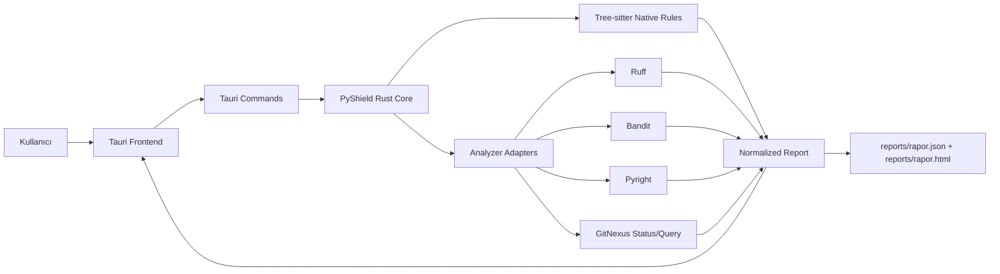
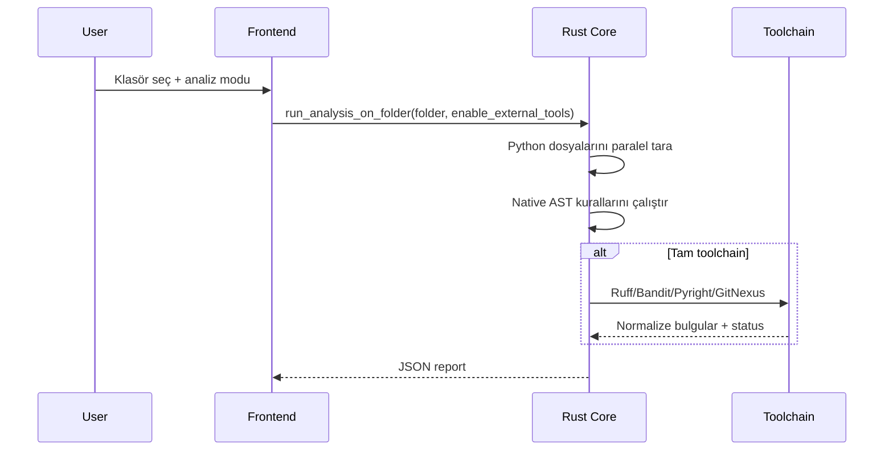

# PyShield

PyShield, AI ile üretilen veya hızla büyüyen Python kodlarını local-first şekilde analiz eden Rust/Tauri tabanlı bir masaüstü uygulamasıdır. Çekirdek amaç, hızlı Rust ön analiziyle çalışma riski taşıyan sorunları bulmak; gerektiğinde Ruff, Bandit, Pyright ve GitNexus sonuçlarını tek raporda birleştirmektir.

## Sistem Özeti

- Native analiz motoru Rust + Tree-sitter Python ile çalışır.
- Dosya tarama `rayon` ile paraleldir.
- Harici araçlar PyShield managed toolchain altında tutulur; hedef repoya Ruff/Bandit/Pyright/GitNexus kurmak gerekmez.
- Tauri frontend klasör seçimi, analiz modu, filtreler, tool status ve GitNexus sorgu paneli sağlar.
- CLI ve Tauri aynı normalize `Issue` şemasını kullanır.



## Analiz Modları

PyShield iki modla çalışır:

- **Hızlı Rust scan:** Sadece native PyShield kuralları çalışır. Büyük repolarda hızlı ilk değerlendirme için kullanılır.
- **Tam toolchain scan:** Native analizden sonra Ruff, Bandit, Pyright ve GitNexus status bilgisi rapora eklenir.



## Kurulum

Gerekenler:

- Rust stable
- Node.js
- Python/uv
- Windows için Tauri build gereksinimleri

Bağımlılıkları kur:

```powershell
npm install
npm run tools:install
cargo test
```

Tauri geliştirme:

```powershell
npm run tauri dev
```

Tauri release build:

```powershell
npm run tauri build
```

Build çıktıları:

```text
src-tauri/target/release/app.exe
src-tauri/target/release/bundle/msi/PyShield_0.1.0_x64_en-US.msi
src-tauri/target/release/bundle/nsis/PyShield_0.1.0_x64-setup.exe
```

## CLI Kullanımı

Hızlı native scan:

```powershell
cargo run -- D:\PROGRAMMING\abey --native-only
```

Tam toolchain scan:

```powershell
cargo run -- D:\PROGRAMMING\abey
```

Raporlar `reports/` altına yazılır:

```text
reports/rapor.json
reports/rapor.html
```

## Managed Toolchain

PyShield araçları hedef projeden bağımsızdır.

```text
.pyshield-tools/
  python/  -> ruff, bandit
  node/    -> pyright, gitnexus
```

Kurulum:

```powershell
npm run tools:install
```

`PYSHIELD_TOOLS_DIR` ortam değişkeniyle paketlenmiş veya özel bir toolchain dizini verilebilir.

## GitNexus Entegrasyonu

GitNexus, repoyu knowledge graph olarak indexleyen ve execution-flow sorguları sağlayan CLI/MCP aracıdır. PyShield içinde GitNexus:

- Tool status olarak index durumunu gösterir.
- Frontend panelinden `status`, `analyze --index-only` ve `query` çalıştırabilir.
- Target repoya zorunlu dependency olarak kurulmaz; PyShield managed toolchain veya PATH kullanılır.

Örnek:

```powershell
gitnexus analyze D:\PROGRAMMING\abey
gitnexus status
gitnexus query -r D:\PROGRAMMING\abey "worker runtime flow"
```

PyShield frontend içindeki GitNexus paneli aynı işlemleri Tauri command üzerinden çalıştırır.

## Klasör Standardı

```text
src/                 Rust analiz motoru
src-frontend/        Tauri statik frontend
src-tauri/           Tauri shell ve commands
tests/fixtures/      Rust regression fixture dosyaları
tests/manual/        Eski manuel Python testleri
examples/            Örnek entegrasyon/kullanım dosyaları
docs/context/        Proje bağlam dokümanları
agent-logs/          Sprint/BL çalışma notları
reports/             Üretilen JSON/HTML raporlar
logs/                Yerel runtime logları
```

Generated/runtime klasörleri `.gitignore` altındadır: `target`, `src-tauri/target`, `node_modules`, `.pyshield-tools`, `.gitnexus`, `reports/*.json`, `reports/*.html`, `logs/*.log`.

## Abey Ölçümü

`D:\PROGRAMMING\abey` üzerinde son ölçüm:

| Mod | Süre | Toplam | PyShield | Bandit | Pyright | GitNexus |
| --- | ---: | ---: | ---: | ---: | ---: | --- |
| Hızlı Rust scan | 14.1 sn | 892 | 892 | - | - | - |
| Tam toolchain scan | 34.6 sn | 1712 | 892 | 129 | 691 | ok |

Önemli kalite düzeltmeleri:

- Test dosyalarındaki Bandit `B101` assert gürültüsü filtrelendi.
- `pyproject.toml` / requirements içinde tanımlı dependency'ler için Pyright missing-import false-positive'leri bastırıldı.
- Windows `\\?\` path normalizasyonu düzeltildi.
- PyShield native halüsinasyon filtresi constructor/class call ve callable parametreleri tanıyacak şekilde iyileştirildi.
- Abey native PyShield toplamı 1764'ten 892'ye; halüsinasyon bulguları 887'den 15'e indi.

## Önceliklendirme Notu

Toplam bulgu sayısı doğrudan “çalışmaz” anlamına gelmez. Çalışma riski için öncelik sırası:

1. `ERROR` severity bulguları
2. Pyright `reportArgumentType`, `reportCallIssue`, `reportReturnType`
3. PyShield `PYSHIELD_SECRET_001`, `PYSHIELD_DANGEROUS_EXEC_001`, `PYSHIELD_LOOP_001`
4. Gerçek source dosyalarındaki missing import/scope bulguları
5. Test ve unused/style uyarıları

## Doğrulama

```powershell
cargo test
npm run tauri build
```

Son doğrulamada Rust testleri 12/12 geçti ve Tauri release build başarıyla üretildi.
